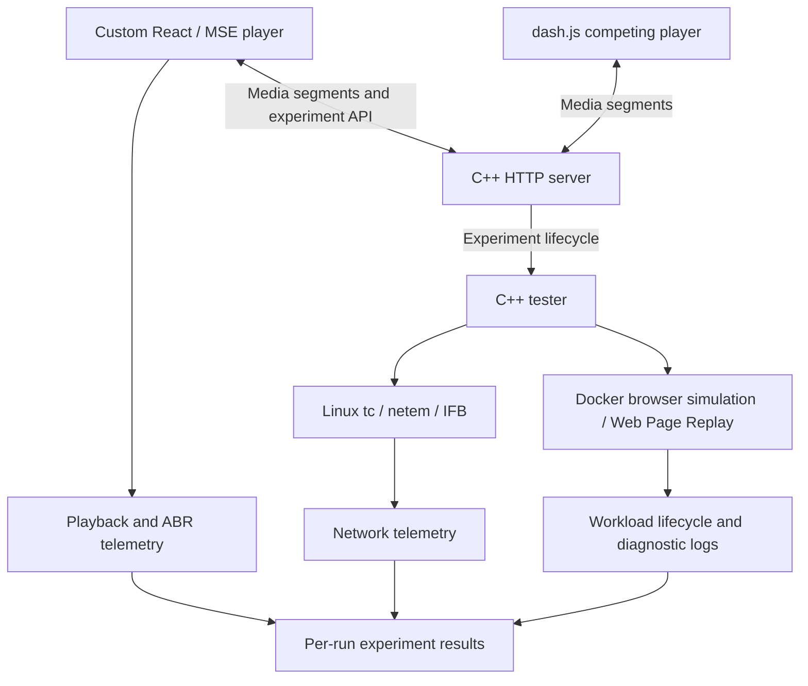

# Adaptive Bitrate Streaming — Experimental Research Platform

An independent project exploring adaptive video streaming, network contention, and playback performance under controlled network conditions.

**Status:** Experimental prototype with preliminary results; ongoing validation.

## Overview

I originally started this project to develop a video player from the ground up and understand the mechanisms behind adaptive bitrate (ABR) streaming. As the project progressed, my focus shifted from implementing a player toward investigating its behavior under changing network conditions and competition from other applications.

The current platform combines a custom MPEG-DASH player, network emulation, competing traffic workloads, automated experiments, and performance telemetry. Its purpose is to explore research questions and develop experimental skills rather than to present a production-ready player or a novel ABR algorithm.

## Research questions

- How does throughput estimation influence bitrate selection and playback stability?
- How does a streaming client behave when it shares a network bottleneck with another streaming client and bursty web traffic?
- What trade-offs arise between adaptation responsiveness, video quality, quality switching, and buffering?
- What explains differences in playback performance between repeated experiments with the same configured network conditions?

## System architecture

Video segment traffic and replayed web traffic are directed into a shared emulated bottleneck using Linux traffic control.

| Component                                      | Purpose                                                                         |
| ---------------------------------------------- | ------------------------------------------------------------------------------- |
| React and Media Source Extensions (MSE)        | Custom DASH playback, segment fetching, buffering, and bitrate adaptation       |
| C++ HTTP server                                | Media delivery, experiment configuration, orchestration, and result persistence |
| C++ tester                                     | Network emulation, browser workload coordination, and network telemetry         |
| dash.js                                        | Competing adaptive video streaming workload                                     |
| Docker, Browsertime, and Web Page Replay (WPR) | Replaying recorded browsing workloads under controlled conditions               |
| Linux `tc`, `netem`, and IFB                   | Shared bandwidth limitation, network delay, and traffic measurement             |

## ABR strategy and experiment controls

The custom player uses measured segment download throughput, recent throughput history, and a configurable safety factor to guide quality selection. Buffer occupancy and estimated download time also influence its download and retry behavior.

The experimental framework supports configurable throughput averaging windows, quality safety factors, buffer targets, download timeout parameters, workload selection, browser scheduling, and repeated runs. A configuration snapshot is saved with the experiment results to record the settings used.

## Preliminary experimental results

A preliminary workload-comparison experiment was conducted using a shared **16 Mbps** bottleneck, **100 ms of configured network delay** (not a measured round-trip time), and a **120-second playback observation window**. The video has three available resolutions: 480p, 720p, and 1080p.

The following results represent five runs per configured workload combination. The custom ABR player is enabled in every configuration. The reported quality duration refers to playback by the custom player, not the competing dash.js client.

| Competing workloads    | Mean 1080p playback (s) | 1080p min–max (s) | Mean quality switches | Total stalls across 5 runs |
| ---------------------- | ----------------------: | -----------------------: | --------------------: | -------------------------: |
| None (baseline)        |                  111.95 |            111.94–111.96 |                   2.0 |                          0 |
| One browser            |                  111.94 |            111.92–111.96 |                   2.0 |                          0 |
| Two browsers           |                  111.94 |            111.93–111.94 |                   2.0 |                          0 |
| dash.js                |                   77.52 |              75.92–83.81 |                   3.4 |                          1 |
| dash.js + one browser  |                   67.93 |              59.93–75.94 |                   5.8 |                          0 |
| dash.js + two browsers |                   39.95 |               0.00–67.93 |                   5.2 |                          0 |

**Configuration caveat:** The baseline used a seven-segment throughput averaging window; the other five reported configurations used five. Workload was therefore not the only varying setting across the full table. See the [per-run data and configuration index](research/experiments/README.md) for the recorded metrics and supplementary runs.

### Observations

- The custom player maintained nearly identical 1080p playback durations in the baseline and browser-only configurations.
- Competition from dash.js was associated with reduced 1080p playback duration. The reduction was greater when browser workloads were enabled alongside dash.js.
- The combined workloads produced considerable run-to-run variability, particularly with two browsers. This motivated the addition of more detailed network and player telemetry.
- In a subsequent instrumented run, traffic-control counters showed both video and replayed web traffic entering the shared bottleneck, along with periods of queue accumulation.

These are exploratory observations, not statistically established conclusions. Five runs per configuration are insufficient to characterize the full variability of the system or isolate every causal factor. The workload configurations indicate which processes were enabled; they do not independently establish that every browser journey or competing playback completed as intended.

## Measurement and telemetry

The framework records playback performance indicators related to Quality of Experience (QoE):

- Playback duration at each resolution
- Startup delay, stall count, and total stall duration
- Quality switch count and history
- Aborted segment downloads

The newer instrumentation additionally records segment download timings and sizes, throughput estimates, buffer occupancy, adaptation events, network traffic counters, IFB queue backlog, and workload lifecycle events.

These measurements are intended to help explain why a particular playback outcome occurred rather than relying exclusively on aggregate performance scores. Resolution duration and stalling are useful performance indicators, but they do not by themselves constitute a validated subjective QoE model.

## Development history and use of AI

### Phase 1 — Personally implemented player (September–November 2026)

I wrote the original project's implementation myself, including the C++ HTTP backend, custom MPEG-DASH playback, buffering, seeking, bitrate adaptation, audio support, and initial experimental tools. I used AI for learning, explanations, and technical discussion, not to generate the implementation code committed during this phase. Third-party libraries and framework scaffolding are separate from my own implementation.

The [November 2 development snapshot](https://github.com/Belboy47/video-streaming-project/tree/39e72e60c9c942c0b9b02f486b65c04064f0d4cc) is the last published snapshot of this phase. The earlier commit history documents the incremental development of the player.

### Phase 2 — AI-assisted experimental research platform (current milestone)

Beginning with this milestone, I delegated substantial implementation work to AI tools as my focus shifted toward network behavior, experiment design, and the interpretation of results. Significant portions of the updated player, C++ experimental infrastructure, workload orchestration, instrumentation, and supporting documentation were generated or revised with AI assistance.

I directed the investigation, selected the experimental questions and configurations, and interpreted the preliminary findings with AI as a technical collaborator. The current implementation should not be mistaken for entirely independently handwritten code. It remains an experimental prototype requiring further review and validation.

## Repository guide

| Path                   | Description                                                   |
| ---------------------- | ------------------------------------------------------------- |
| `main.cpp`             | C++ HTTP backend and experiment orchestration                 |
| `frontend/src/App.jsx` | Custom ABR player and playback instrumentation                |
| `tester/tester.cpp`    | Linux network emulation, workload coordination, and telemetry |

Additional published files include `tester/experiment-parameters.js` (workload and ABR controls), `frontend/src/CompetingPlayer.jsx` (dash.js workload), `frontend/src/QoEResult.jsx` (results display), `digikala-journey.mjs` (browser replay journey), and `third_party/` (cpp-httplib and nlohmann/json headers and license notices). The DASH media assets and recorded WPR archive are not included.

Experiments generate configuration snapshots, per-run JSON results, average results, and, in the newer instrumented version, telemetry JSON and tester logs.

### Experimental environment

The platform has been developed and tested in a WSL2/Linux environment. Running the full experiment requires a compatible browser and Node.js/React environment, a C++17 compiler, cpp-httplib and nlohmann/json headers, Linux traffic-control/IFB support, Docker, the media assets, and the browsing replay archive and scripts. Network emulation requires appropriate Linux privileges.

The frontend manifest and lockfile are the supplied project files, but do not declare dash.js; see [frontend setup notes](frontend/README.md). The current browser journey handles its own seed and timing; the controller configuration alone does not guarantee identical browser timing or randomization. The vendored C++ headers match the supplied copies of cpp-httplib 0.63.0 and nlohmann/json 3.12.0.

This repository is an experimental development snapshot. A complete, independently verified setup and reproduction procedure is not yet documented here; the source files alone may not be sufficient to reproduce the full experiment.

## Limitations and future work

- Validate browser replay reliability and individual workload health, including observed replay request failures and browser initialization warnings.
- Perform additional repeated experiments and analyze uncertainty and the causes of run-to-run variation.
- Improve per-client traffic attribution and distinguish traffic offered to the bottleneck from traffic actually delivered. Current port-based network counters aggregate video clients and aggregate replayed browser traffic.
- Improve cross-process timing alignment and evaluate the effects of throughput estimation and buffer-management parameters.
- Account for a historical 480p/720p playback-counter labeling error in older results before comparing lower-resolution durations across versions. The 1080p duration counter was unaffected by that specific error.
- Develop a more complete evaluation methodology, including appropriate ABR baselines and QoE models.

The next objective is to consolidate the experimental findings and identify a more focused research direction before extending the implementation further.
